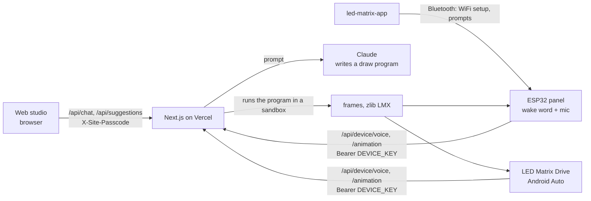

# LED Matrix Studio

Describe an animation in words and an AI draws it on an LED matrix. This repo is the server and
web studio behind a small family of LED Matrix projects, plus the firmware for a real 64×32 panel.

- **Web studio** (`app/`): chat with the AI, watch the result on a virtual 64×32 matrix, edit the
  generated code, and send it to a panel over USB.
- **Screens API** (`app/api/device/`): panels and apps send a prompt (typed or spoken) and get
  finished frames back in a compact format.
- **Panel firmware** (`firmware/player/`): an ESP32-S3 that plays animations, joins WiFi, listens
  for a wake word and records voice prompts.

Related projects that use the same server:

- [led-matrix-app](https://github.com/smartcreations/led-matrix-app): phone app that sets up a panel over Bluetooth.
- [led-matrix-drive](https://github.com/smartcreations/led-matrix-drive): LED Matrix Drive, an Android Auto app that turns the car screen into an LED matrix.

## How it fits together



The AI never sends pixels. It writes a tiny JavaScript `draw(...)` program; the browser (in a
Web Worker) or the server (in a locked-down worker, `lib/renderServer.ts`) runs it into frames.

- `components/LedMatrix.tsx`: the virtual display.
- `lib/animation.ts`: renders generated code into frames in the browser.
- `lib/prompt.ts`: the system prompt and the `createAnimation` tool schema.
- `lib/router.ts`: decides whether a screen's prompt is a drawing or a question to answer.
- `lib/deviceAnimation.ts`: prompt to Claude to frames to the `LMX1` upload format for screens.
- `lib/lmx.ts`: the binary format (header, RGB565 pixels, optional zlib).

## Run it

```bash
npm install
cp .env.example .env.local    # then fill in a key
npm run dev                   # http://localhost:3000
```

The demos and the code editor work without a key; only the AI needs one.

| Variable | What it does |
| --- | --- |
| `ANTHROPIC_API_KEY` | Claude directly. Or set `AI_GATEWAY_API_KEY` to go through Vercel AI Gateway. |
| `AI_GATEWAY_API_KEY` | Needed for voice prompts (speech to text) and for non-Anthropic models. |
| `DEVICE_KEY` | Shared secret for `/api/device/*`. Screens send `Authorization: Bearer <key>`. |
| `SITE_PASSCODE` | Locks the web studio's AI routes. Unset means open (fine on localhost). |
| `LED_MODEL`, `DEVICE_MODEL`, `ROUTER_MODEL`, `SUGGESTIONS_MODEL`, `TRANSCRIBE_MODEL` | Optional model overrides. |
| `DEVICE_JUDGE` | `on` lets a second model check screen animations before sending them. |

## Deploying it publicly

Anyone who finds your URL can call the AI routes and spend your API credits, so before you share a
deployment:

1. **Set `SITE_PASSCODE` and `DEVICE_KEY`** in your Vercel project's environment variables. The
   web page asks for the passcode once and remembers it in the browser.
2. **Add a rate limit.** In Vercel, Firewall → Add rule: requests to `/api/` above, say,
   20 per minute per IP get rate limited.
3. **Cap your spend.** Set a monthly limit in the Anthropic Console (and on the AI Gateway if you
   use it). This is the backstop if a key ever leaks.

Keys live only in Vercel and in your local `.env.local`, which git ignores. Never put them in code.

## The panel

`firmware/player/` runs on a Waveshare ESP32-S3-RGB-Matrix board with a 64×32 HUB75 panel
(Arduino, `ESP32-HUB75-MatrixPanel-I2S-DMA`). It:

- plays an animation from flash and takes new ones over USB from the web studio;
- runs a setup hotspot and a small web page, and accepts WiFi details from the phone app over Bluetooth;
- listens for a wake word ("Hey bro", `firmware/models/`) and records the prompt that follows.

The server URL and device key are typed in at setup, not built into the firmware.
`firmware/panel_test/` is a wiring check, and `firmware/tools/` has helpers for WiFi setup over
USB and for turning a wake-word model into a header.

## Build your own with Claude

Paste this into Claude Code (or any coding agent) in an empty folder to get the skeleton:

```text
Build an "LED Matrix" project: an AI draws animations for a 64x32 LED matrix.

1. A Next.js app (App Router, TypeScript, Vercel AI SDK, Anthropic provider). A chat route where
   Claude answers by calling a createAnimation tool with { title, fps, durationMs, code }, where
   code is a JavaScript function draw(ctx, t, width, height) that paints one frame on a canvas.
   The browser runs that code in a Web Worker with a time limit, thresholds each pixel and shows
   the frames on a virtual dot-matrix component. Add a code editor and a few built-in demos.
2. A device API: POST /api/device/animation { prompt } with "Authorization: Bearer DEVICE_KEY"
   returns the frames as a small binary format (magic "LMX1", width, height, fps, frame count,
   RGB565 pixels, optional zlib). Run the generated code server-side in a worker thread with no
   environment variables, no network and a memory and time cap.
3. Protect the AI routes with a SITE_PASSCODE header check, keep every key in environment
   variables, and add .env.example and a README.
Start with the web app and one demo, then the device API.
```

For the ESP32 firmware or the Android Auto app, see `firmware/player/player.ino` and
[led-matrix-drive](https://github.com/smartcreations/led-matrix-drive) for how they're put together.

## Credits

- `firmware/libraries/MicroFrontend`: TensorFlow Lite Micro audio frontend, Apache License 2.0 (see its `LICENSE`).
- `lib/font.ts`: the classic public 5×7 pixel font found in many LED and LCD libraries.
- Built with Claude Code.

## License

MIT, see [LICENSE](LICENSE).
